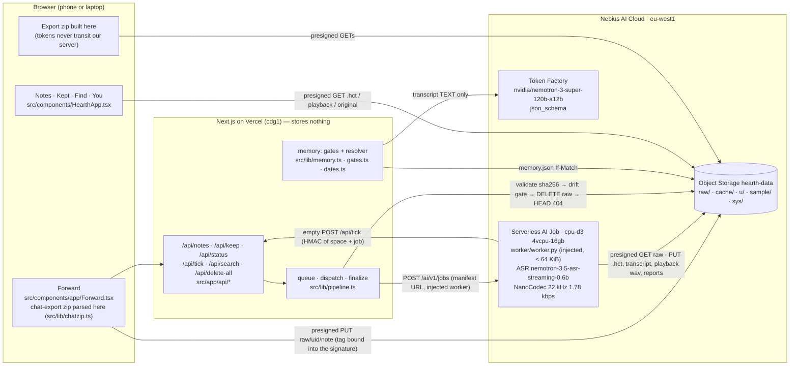
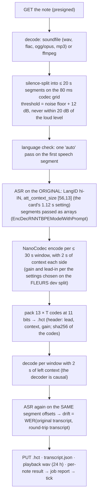

# Hearth — architecture

Hearth keeps a family's voice notes as NVIDIA NanoCodec tokens with a Hindi transcript, and turns what a note
asks for into reminders quoted word for word. This document describes the code in this repository; every box
below names the file that implements it.

## The one flow

## Inside the Job (`worker/worker.py`)

The worker is one stdlib-only-at-import Python file, injected into a stock `python:3.11` image together with
`worker/run.sh` (which installs `worker/requirements.txt` with `uv`) — a failed install is still reported through the
status URL. It never holds a credential: every read and write is a presigned URL from its manifest.

Modes: `keep` (the pipeline above), `decode` (rebuild an expired playback copy from tokens), `d0` (the benchmark
harness: the same pipeline over FLEURS clips, plus determinism, memory and load-time checks).

## On the app side (`src/lib/pipeline.ts`)

- **Queue.** At most one Hearth Job at a time. The tenant quota is 2 instances per region and is shared with the
  builder's other projects; Nebius creates a third job and ends it with `QuotaExceeded`. So `dispatch()` first counts
  the region's live jobs, and a `QuotaExceeded` or HTTP 429 is a requeue with backoff (30 s doubling to 4 min), never a
  spent attempt. Each queue entry is claimed with `If-None-Match: *`, so two concurrent requests cannot both dispatch it.
- **Validation.** A note's result is trusted only when its job id and note id match and the sha256 of the `.hct` the
  app reads back equals the one the worker reported.
- **Drift gate** (a fixed prior): note drift ≤ 5 % and ≤ 30 % for every segment of ≥ 8 words. Passing notes keep their
  original for a 24 h grace (so the user can A/B), then the app DELETEs it and HEADs it: "deleted" means `raw/` **and**
  `u/<uid>/originals/` both return 404, recorded with the check time. Failing or failed notes are copied to
  `originals/` (tag replaced) before `raw/` is cleared.
- **Spend meter** (`src/lib/caps.ts`). Every create reserves its 1 h worst case (the timeout is set explicitly; the API
  default is 24 h) and is settled from its real duration. Uid-free, so delete-all cannot reset it.

## Memory (`src/lib/memory.ts`, `gates.ts`, `dates.ts`, `hindi/*`)

Nemotron 3 Super proposes items with `response_format: json_schema` (`src/lib/tf.ts`); code decides what is shown.

1. **Quote gate** — the quote, normalised (`src/lib/hindi/normalize.ts`), must occur on whole-token boundaries in the
   transcript. Otherwise the item is dropped and counted.
2. **Field gate** — the amount must be one the quote itself expresses (`numbers.ts`: full 0–99 table, सौ/हज़ार/लाख,
   डेढ़/ढाई, साढ़े/सवा/पौने); a weekday needs its qualifier's marker adjacent (`weekdays.ts`); कल/परसों need a future or
   imperative verb. Otherwise the field is removed ("amount not stated", "date unclear").
3. **Resolver** — due dates from the note's own timestamp, never the LLM: "before Sunday" is the day before.
4. **Write** — `memory.json` with `If-Match`; a 412 re-reads and re-merges. A later «पैसे मिल गए» marks an earlier money
   ask received only when Super links them and the amounts agree.

Privacy gate: transcript text reaches Token Factory only for the sample, with Zero Data Retention on for the
organisation (`TF_ZDR_ON`), or after the space opts in under the default-retention sentence (`src/lib/copy.ts`).

## Storage layout (`src/lib/keys.ts`)

| Prefix | Holds | Lifecycle |
|---|---|---|
| `raw/<uid>/` | uploads | deleted by the app after a verified round trip; rule: 7 days (backstop) |
| `cache/<uid>/` | Job-decoded playback copies | rule: 1 day |
| `u/<uid>/` | `.hct`, transcripts, meta, memory, job reports, kept originals | tag `space=anon`: 7 days; `space=kept`: none |
| `sample/` | the judge sample | none |
| `sys/` | queue, claims, active markers, uid-free daily counts, spend meter | — |

Every PUT carries `x-amz-tagging` (for presigned PUTs the tag is inside the signature).

## Calendar, search, export

- `/api/reminders.ics` (`src/lib/ics.ts`): RFC 5545, neutral titles only, `VALARM` unless the date has passed; the
  feed key rotates with delete-all (old URL → 410). Android gets a Google Calendar subscribe link and per-coupon links.
- `/api/search` (`src/lib/search.ts`): the query is in the body; Super expands it; BM25 over the Devanagari and its
  gloss ranks real segments; the player seeks there.
- `/api/export`: presigned GETs; the browser builds the zip, with `export/decode.py` to play the tokens without Hearth.

## Tests

`npm test` (vitest): SigV4 against AWS's published vectors, the Hindi normaliser and number table, 34 resolver cases,
the gates, memory merging, search and the calendar feed, the `.hct` format across Python and TypeScript, the chat-export
privacy contract, and the pipeline (queue, QuotaExceeded requeue, retries, sha256 validation, the drift gate, verified
deletion, the spend meter) against an in-memory S3 and a fake Jobs API. `python3 -m pytest worker scripts`: the
worker's packing, segmentation, windowing and gain. `npm run test:live`: real Nebius and Token Factory.
