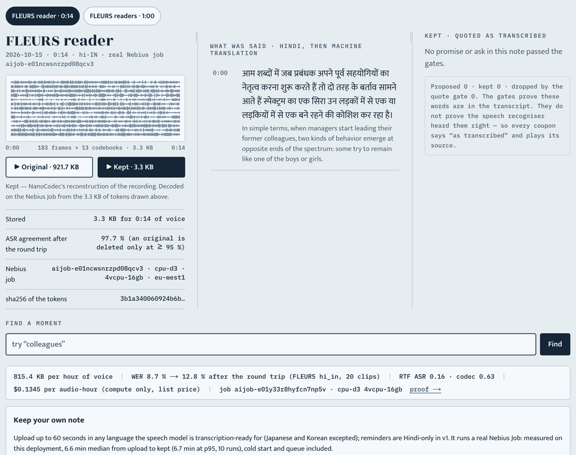
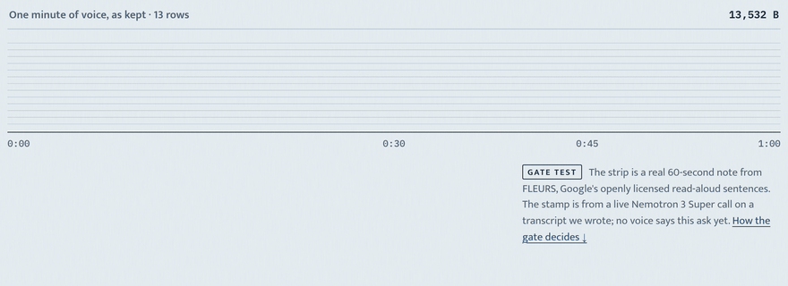
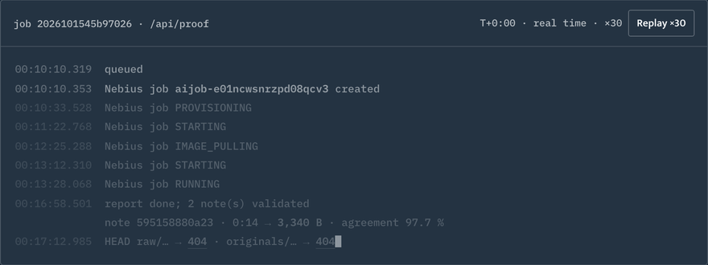
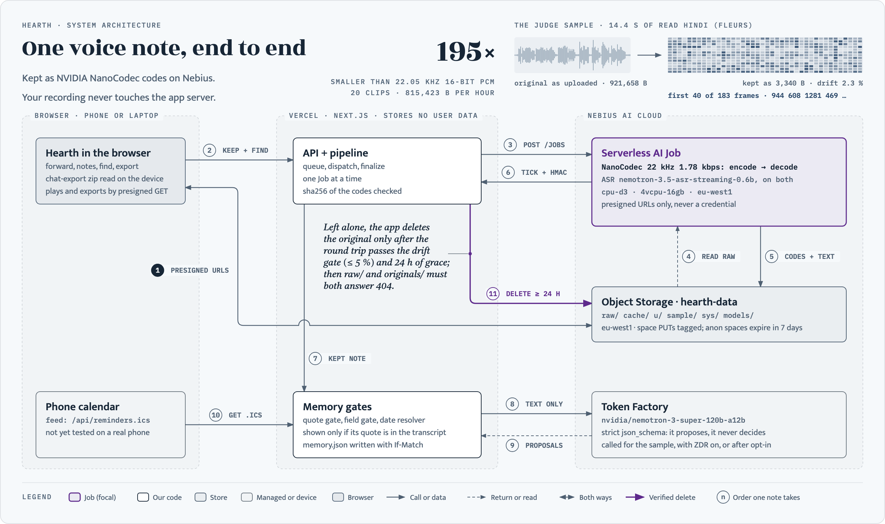
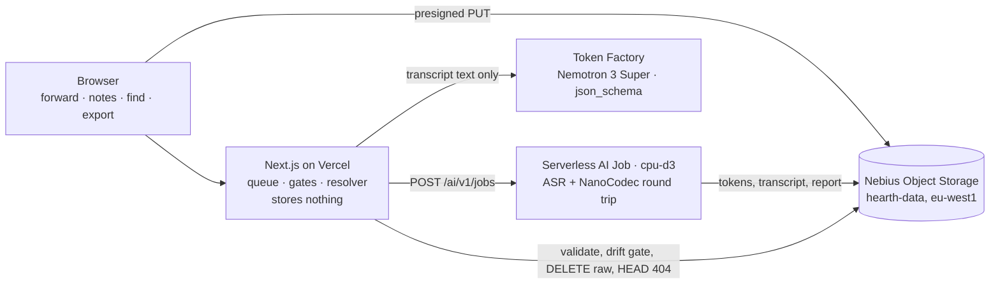

<div align="center">
  
  <h1>Hearth 🗣️</h1>
  <p><em>Forward the family voice notes. Each voice is kept as codec tokens with a searchable Hindi transcript, and every promise in it becomes a reminder quoted word for word.</em></p>
  

  <p><strong>Measured on Nebius Serverless AI Jobs (CPU only):</strong> <!--n:bytes_per_hour-->815,423<!--/n--> bytes per hour of voice
  (<!--n:x_smaller_pcm-->195<!--/n-->× smaller than 22.05 kHz 16-bit PCM). Hindi word error rate
  <!--n:wer_orig-->8.74<!--/n--> % on the original, <!--n:wer_rt-->12.83<!--/n--> % after the codec round trip
  (<!--n:wer_delta-->+4.09<!--/n--> pts) on <!--n:clips-->20<!--/n--> FLEURS <code>hi_in</code> clips. The hero above is a design illustration;
  the numbers are from Job <code><!--n:d0_job-->aijob-e01y33r8hyfcn7np5v<!--/n--></code>.</p>

  <br/>

  [](https://hearth.edycu.dev/judge)
  [](https://hearth.edycu.dev/about)
  [](https://youtu.be/VMcvyFoCKO4)
  [](https://hearth.edycu.dev/proof)
  [](https://hearth.edycu.dev/pitch)
  [](FEEDBACK.md)
  [](https://nebiusglobalaihackathon.devpost.com/)

  <br/>

  
  
  
  
  
  [](LICENSE)
  [](https://github.com/edycutjong/hearth/actions/workflows/ci.yml)
  [](https://github.com/edycutjong/hearth/releases)

</div>

---

> **No account, no install:** open [/judge](https://hearth.edycu.dev/judge) (one note kept by the real pipeline, original
> and kept side by side), then [/proof](https://hearth.edycu.dev/proof) (Job IDs, timings, the `HEAD … 404` on the raw audio).
> Or read the benchmark of record: [`bench/results/latest.json`](bench/results/latest.json). What we learned building it on Nebius and
> NVIDIA, for the teams that run them: [**FEEDBACK.md**](FEEDBACK.md). Full walkthrough: [DEMO.md](DEMO.md).

## 📸 See it in Action

`/judge` plays the same note twice: the original, then NanoCodec's reconstruction decoded from the codec tokens drawn under the player
(13 rows = 13 codebooks, 12.5 columns per second). Beside them sit the Hindi transcript, how many words the ASR still reads the same
after the round trip, and a search box that jumps to the segment holding a word, in Hindi or English.

Until the consented, actor-voiced family sample exists, the sample note is **FLEURS read speech** (Google FLEURS `hi_in`, CC BY 4.0),
and the page says so. It is not a family note and is never presented as one.

<p align="center"></p>

<sub>▶ Original, then ▶ Kept: one playhead over the token strip the kept audio is decoded from; a search for “colleagues” lands on the Hindi segment. Live <a href="https://hearth.edycu.dev/judge">/judge</a>, real time, silent.</sub>

<p align="center"></p>

<sub>The <a href="https://hearth.edycu.dev/about">/about</a> signature: a real one-minute strip, the postmark at 0:15, the reminder slip. Labelled <b>gate test</b> on the page: the stamp comes from a live Nemotron 3 Super call on a transcript we wrote, not from a family voice.</sub>

<p align="center"></p>

<sub>The judge sample's own Job record from <code>/api/proof</code>, replayed by the page at ×30 and shown here at 2× that, ending on <code>HEAD raw/… → 404</code>.</sub>

## 💡 The Problem & Solution

### The Problem
A parent sends a Hindi voice note every week. The ask is buried at 0:15 ("send ₹5,000 before Sunday"), the note is megabytes of audio
nobody searches, and the voice is the one thing you cannot get back.

### The Solution
Forward the notes to Hearth. For each one, a Nebius Serverless AI Job transcribes it, encodes it with NVIDIA NanoCodec, decodes it again
and re-transcribes the result. Hearth deletes the raw audio by itself **only if the round trip holds** (after a 24 h grace; you can also delete it by hand at any
time), and proves the deletion with a `HEAD` that returns 404. A note that drifts past the gate keeps its original. What stays is the token strip and the transcript. Promises (money, dates, appointments) are proposed by
Nemotron 3 Super, then checked by code: a promise is shown only if its quote is verbatim in the transcript, and amounts and due dates
are re-derived from that quote by code, never taken from the model. Reminders are published as a standard calendar feed (RFC 5545, with
alarms) for a phone's calendar to subscribe to; delivery on a real phone is not yet tested.

## 🏗️ Architecture & Tech Stack

<p align="center"></p>

The numbers follow one note through the system. The header is the judge sample's real data: its waveform as uploaded, and the first 40 of its 183 NanoCodec frames. Details and the file behind each box: [ARCHITECTURE.md](ARCHITECTURE.md).

<details>
<summary>The same flow as a Mermaid diagram</summary>



</details>

| Layer | Choice |
|---|---|
| App | Next.js 15 (App Router, TypeScript) on Vercel; stores nothing, no SQL database |
| Worker | One Python file (gzipped, with a launcher script and its pinned requirements) injected into a stock `python:3.11` image, run as a Nebius Serverless AI Job (`cpu-d3`, `<!--n:preset-->4vcpu-16gb<!--/n-->`, eu-west1) |
| Speech | NVIDIA `nemotron-3.5-asr-streaming-0.6b` (hi-IN, 1.12 s operating point) and `nemo-nano-codec-22khz-1.78kbps-12.5fps` |
| Language model | Nebius Token Factory, `nvidia/nemotron-3-super-120b-a12b`, `response_format: json_schema` |
| Storage | Nebius Object Storage: presigned PUT/GET, `If-Match` conditional writes for versioned memory |

## 🏆 NVIDIA + Nebius Integration

| Surface | What Hearth does with it | Code |
|---|---|---|
| NVIDIA NanoCodec `AudioCodecModel.encode` / `.decode` | encode each note into 13 × 12.5 codes per second (the stored format); decode for playback and for the round-trip check that gates deletion | `worker/worker.py` |
| NVIDIA `nemotron-3.5-asr-streaming-0.6b` (`att_context_size=[56,13]`, `target_lang=hi-IN`) | transcribes the original (search index) and the round trip (quality gate) | `worker/worker.py` |
| Nebius Serverless AI Jobs, `POST /ai/v1/jobs`, injected files | runs both models per upload on CPU; the app requeues on `QuotaExceeded` | `src/lib/nebius/jobs.ts`, `src/lib/injected.ts`, `src/lib/pipeline.ts` |
| Nebius Token Factory chat completions, Nemotron 3 Super, `json_schema` | proposes promises, dates and amounts; expands search queries; transcript text only | `src/lib/tf.ts` |
| Nebius Object Storage (SigV4) | per-class prefixes, presigned PUT/GET, `DELETE` + `HEAD` 404 proof, `If-Match` merge of `memory.json`, `ListObjectsV2` for delete-all (a 7-day expiry for anonymous spaces is set on the bucket) | `src/lib/nebius/storage.ts`, `src/lib/memory.ts` |

Deliberate refusals: NemoClaw, OpenShell and Hermes Agent are named in the track text and **not used** (the one flow needs no agent runtime
and judges could not install them). Tavily is not used either: nothing in the flow needs the live web.

## 📊 Engineering Rigor

| Measure | Result |
|---|---|
| Unit and integration tests | **457** vitest (26 files) + **205** pytest, all passing |
| Coverage (enforced in CI) | **100 %** statements, branches, functions and lines on `src/lib` (vitest, v8); **100 %** statements on `worker/` + `scripts/` (pytest-cov) |
| Browser tests | 13 Playwright tests × 2 projects (desktop 1440 px, phone 375 px), no credentials |
| ASR real-time factor on 4 vCPU | <!--n:asr_rtf-->0.16<!--/n--> (gate ≤ 0.5) |
| Peak memory | <!--n:peak_rss_gb-->6.9<!--/n--> GB (gate ≤ 12 GB) |
| Cost per hour of voice | $<!--n:usd_per_audio_hour-->0.1345<!--/n--> — compute only: the measured real-time factor × the cpu-d3 list price; Job start-up, install and model load excluded (gate ≤ $0.60) |
| Held-out set `fleurs20b`, never used for a decision | <!--n:wer_orig_b-->12.42<!--/n--> % → <!--n:wer_rt_b-->14.46<!--/n--> % |
| Live keeps through the deployed app | <!--n:live_kept-->10<!--/n-->/<!--n:live_runs-->10<!--/n--> kept; upload → kept p50 <!--n:ttk_p50_s-->394<!--/n--> s, p95 <!--n:ttk_p95_s-->402<!--/n--> s, cold start included |

An earlier run **failed** the round-trip gate (+5.94 pts) before the codec input was level-normalised; it is committed beside the passing run
(`bench/results/d0-20261014T222337Z-4vcpu-16gb.json`).

### Honest limits (7)

1. **CPU speed is ours.** Neither NVIDIA card states CPU support; every speed number here was measured on `cpu-d3`.
2. **Time to kept is minutes, not seconds.** Most of the ~<!--n:ttk_p50_min-->6.6<!--/n--> min is the Job starting and loading two models
   (≈<!--n:create_to_container_s-->164<!--/n--> s to a running container, then install and model load); the work itself is about a minute for a 60 s note.
3. **Nemotron 3 Super's card does not list Hindi.** That is why the quote gate and field gate exist: its mistakes are dropped and counted, not shown.
4. **The round trip is lossy.** It adds <!--n:wer_delta-->+4.09<!--/n--> WER points on average; one normal-level clip got worse
   (13.0 % → 47.8 %). A note whose drift exceeds the gate keeps its original: 15 of the 20 clips were under the gate. The 60 s live-test note
   is one that drifted (14.7 %), so its original is kept until the user deletes it.
5. **Reminders are Hindi-only.** Other transcription-ready languages (not Japanese or Korean) are kept and searchable, without reminders.
6. **No offline claim.** Playback and export need the object store; the export zip plus `export/decode.py` recovers audio without Hearth.
7. **Retention.** Token Factory may keep prompts and outputs for Speculative Decoding (stored in Finland, never used for training) unless Zero Data
   Retention is confirmed for the organisation. Until then non-sample spaces see this sentence and must opt in before any transcript text is sent.
   Consent and retention wording is awaiting a native Hindi reviewer.

## 🚀 Getting Started

### Prerequisites
Node 22 (what we built and tested on), Python 3.11+. No cloud account is needed to run the tests or to recompute the benchmark.

### Installation
```bash
git clone https://github.com/edycutjong/hearth && cd hearth
npm ci && npm test                        # vitest: 457 tests, 100 % coverage gate (npm run test:coverage)
python3 -m venv .venv && .venv/bin/pip install -r requirements-dev.txt jiwer
.venv/bin/python -m pytest -q worker scripts --cov=worker --cov=scripts --cov-fail-under=100   # 205 tests
.venv/bin/python scripts/d0_report.py bench/results/d0-20261014T231930Z-4vcpu-16gb-raw.json   # recompute the benchmark
```

Running your own Jobs needs a Nebius project and Token Factory key; see [DEMO.md](DEMO.md) for the environment and the cost (cents).

## 🧪 Testing & CI

```bash
make ci               # eslint, tsc, vitest + coverage, npm audit, ruff, pytest (npm run ci + the Python half)
make e2e              # production build + Playwright, desktop + phone, no credentials needed
make security-scan    # production audit + gitleaks over the full history
npm run test:live     # real Nebius + Token Factory (spends cents)
```

| Layer | Tool | Where |
|---|---|---|
| Quality | ESLint, `tsc --noEmit`, vitest with v8 coverage (Node 20/22/24 on `main`), ruff + pytest on the Python worker | `ci.yml` stage 1 |
| Secrets | TruffleHog (verified) + gitleaks over the full history | `ci.yml` stage 2, `gitleaks.yml` |
| Dependencies | `npm audit --omit=dev`, `pip-audit`, license check, Dependabot (grouped, no major bumps; `worker/requirements.txt` is left out of version updates because its pins are the benchmarked environment — its security alerts are fixed by a re-measured bump (hydra-core, DEMO.md §2) or dismissed with a reachability note where the fix breaks NeMo 3.0.0) | `ci.yml` stage 2, `dependabot.yml` |
| Build | `next build` with a bundle-size budget | `ci.yml` stage 3 |
| E2E | Playwright against the production build with no credentials: `/judge`, `/proof`, `/about`, `/pitch`, 404, 375 px | `ci.yml` stage 4 |
| Performance | Lighthouse CI on `/judge` and `/proof` (accessibility ≥ 0.9 is a hard gate, the rest advisory) | `ci.yml` stage 5 |
| SAST | CodeQL (JavaScript/TypeScript + Python); runs once the repo is public, because code scanning needs GitHub Advanced Security on a private repo | `codeql.yml` |
| Releases | Semantic version tags from Angular-style commit messages | `release.yml` |

**Honest CI status.** GitHub Actions was blocked on the account's billing while this repo was private, so no workflow
job ever started there (each run failed at once on the billing block). Most of the same commands were run locally instead (eslint, tsc,
vitest, ruff, pytest, npm audit, pip-audit, gitleaks, the build with its bundle budget, Playwright; Node 22 only), and their output is kept in
`evidence/ci-local-2026-10-15.txt` and, after the story page and deck were added, `evidence/ci-local-2026-10-15-site.txt`.
TruffleHog, the license check, Lighthouse CI and the Node 20/24 legs have not run yet. Fixing the billing (or making the repo public, which makes
Actions free) should be all the pipeline needs.

## 📁 Project Structure

```
src/app, src/components   Next.js routes: /, /judge, /proof, /api/*
public/                   the judge sample's files, the story page (/about) and the pitch deck (/pitch)
src/lib                   pipeline, gates, Hindi date + number resolver, SigV4, Nebius clients, .hct format
worker/                   the Job: segment → ASR → NanoCodec → pack → decode → re-ASR → drift
bench/results/            every benchmark measurement behind a number on this page (test counts: evidence/ci-local-*.txt)
evidence/                 recorded checks: CI logs, the live Token Factory call, the export decode check, a live keep, storage preflight, the bucket's expiry rules, cron sweep, the injected-file limit
export/                   decode.py: tokens back to audio outside Hearth
```

## 📽️ Demo Materials

[Live app](https://hearth.edycu.dev) · [/judge](https://hearth.edycu.dev/judge) · [/proof](https://hearth.edycu.dev/proof) ·
[Story page (/about)](https://hearth.edycu.dev/about) · [Pitch deck (/pitch)](https://hearth.edycu.dev/pitch) ·
[DEMO.md](DEMO.md) · [FEEDBACK.md](FEEDBACK.md) · [ARCHITECTURE.md](ARCHITECTURE.md) · [docs/SOURCES.md](docs/SOURCES.md) (where the outside facts come from)

## 📄 License

MIT. Model weights are downloaded at run time and never committed. FLEURS clips are CC BY 4.0 (Google).
